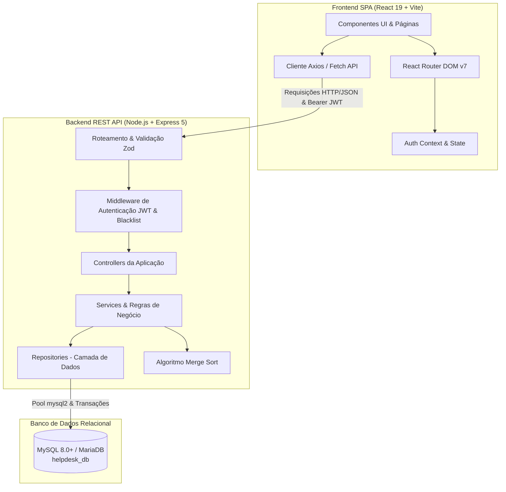
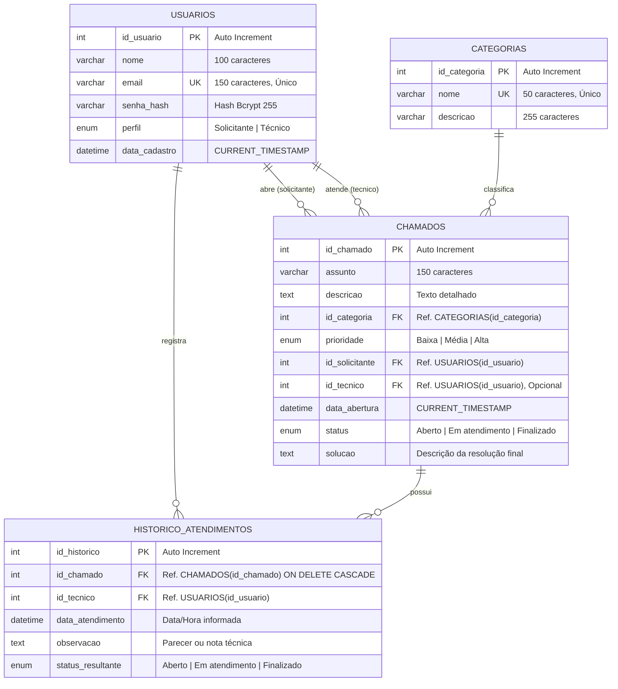

# Documentação do Sistema Helpdesk — Gestão de Chamados de Suporte Técnico

**Atividade Prática — Turma DESI 2025/1 N1**  
**Data de Referência:** 10/11/2026  
**Tema:** Helpdesk — Sistema de Chamados  

---

## 1. Contextualização e Visão Geral

No ambiente corporativo, a gestão centralizada das demandas de suporte técnico é essencial para evitar o extravio de informações, assegurar tempos de resposta adequados e manter a rastreabilidade dos atendimentos. O **Sistema de Helpdesk** foi projetado e desenvolvido como uma aplicação web completa (Full Stack) voltada à abertura, acompanhamento, atribuição e resolução de chamados de tecnologia da informação.

O sistema opera com controle de acesso baseado em papéis (**RBAC - Role-Based Access Control**), contemplando dois perfis fundamentais de usuários:
- **Solicitante:** Colaborador que registra incidentes ou requisições de serviço, acompanha o ciclo de vida dos seus chamados, podendo editá-los ou excluí-los exclusivamente enquanto estiverem com status **"Aberto"** e sem intervenção técnica.
- **Técnico:** Profissional de TI com visão global de todos os chamados da organização, responsável por assumir atendimentos, registrar notas e pareceres no histórico de atendimento e homologar a finalização com a descrição obrigatória da solução aplicada.

---

## 2. Arquitetura da Aplicação e Tecnologias

A aplicação é dividida em duas camadas desacopladas (Frontend SPA e Backend REST API) integradas a um banco de dados relacional.

### 2.1. Visão Geral da Arquitetura



### 2.2. Tecnologias Utilizadas

#### Frontend:
- **React 19:** Biblioteca declarativa para construção de interfaces reativas com componentes funcionais e hooks customizados.
- **Vite 8:** Ferramenta de build de alto desempenho e servidor de desenvolvimento ultrarrápido.
- **Tailwind CSS v4:** Framework de estilização utilitária para layout responsivo, moderno e limpo.
- **React Router DOM v7:** Gerenciamento centralizado de rotas cliente e rotas protegidas (`ProtectedRoute`).
- **Lucide React:** Biblioteca de ícones vetoriais padronizados.

#### Backend:
- **Node.js (v18+):** Ambiente de execução JavaScript assíncrono server-side.
- **Express 5:** Framework minimalista para criação das rotas e middlewares da API REST.
- **MySQL2 (com Connection Pool & Transações):** Driver de conexão assíncrona ao banco de dados relacional com suporte a `Promise`, prepared statements e `withTransaction`.
- **Zod:** Validação estrita de schemas em tempo de execução para parâmetros de rota, query strings e bodies JSON.
- **JSON Web Token (JWT):** Geração e verificação de tokens stateless para autenticação, acompanhado de lista negra em memória (`tokenBlacklist`) para revogação imediata em logouts.
- **Bcrypt:** Algoritmo seguro de derivação de chave com fator de custo (*salt rounds = 10*) para armazenamento de senhas com hash criptográfico irreversível.
- **Merge Sort Customizado:** Implementação de algoritmo clássico de ordenação $O(N \log N)$ para garantir a ordenação cronológica estrita das filas de atendimento.

---

## 3. Requisitos Funcionais (RF)

| ID | Nome do Requisito | Descrição | Perfil Autorizado |
| :--- | :--- | :--- | :--- |
| **RF01** | Autenticação de Usuários | Permitir que usuários realizem login informando e-mail e senha válidos, recebendo token de acesso assinado. | Público |
| **RF02** | Validação de Credenciais | Validar campos obrigatórios e rejeitar dados inválidos com a mensagem *"E-mail ou senha inválidos"*, mantendo o usuário na tela de login. | Público |
| **RF03** | Proteção de Rotas e Telas | Bloquear o acesso a qualquer tela ou endpoint interno para usuários não autenticados (redirecionando ao login). | Sistema |
| **RF04** | Encerramento de Sessão (Logout) | Permitir que o usuário encerre sua sessão ativa, invalidando o token no cliente e adicionando seu identificador à lista de revogação no servidor. | Solicitante / Técnico |
| **RF05** | Exibição de Identificação do Usuário | Exibir nome e perfil do usuário logado na interface principal e no cabeçalho do sistema. | Solicitante / Técnico |
| **RF06** | Contadores do Dashboard | Apresentar na tela inicial os quantitativos de chamados por status (*Aberto*, *Em atendimento*, *Finalizado*). Solicitantes visualizam somente seus registros; técnicos visualizam os de toda a organização. | Solicitante / Técnico |
| **RF07** | Listagem Geral de Chamados | Listar os chamados cadastrados exibindo número de identificação, assunto, categoria, prioridade, data/hora de abertura e status. | Solicitante / Técnico |
| **RF08** | Restrição de Visibilidade | Garantir que o solicitante visualize estritamente os chamados abertos por ele mesmo, enquanto o técnico tem permissão de leitura sobre todos os chamados. | Sistema |
| **RF09** | Busca e Filtro de Chamados | Permitir a filtragem dinâmica da listagem de chamados através de busca textual por número ou assunto. | Solicitante / Técnico |
| **RF10** | Abertura de Chamado | Permitir que o solicitante registre novo chamado informando assunto, descrição, categoria (*Hardware*, *Software*, *Rede*) e prioridade (*Baixa*, *Média*, *Alta*). | Solicitante |
| **RF11** | Atribuição Automática na Criação | Ao criar um chamado, o sistema gera o ID sequencial único, registra o carimbo de data/hora atual, vincula o solicitante autenticado e define status inicial *"Aberto"*. | Sistema |
| **RF12** | Edição de Chamado Próprio | Permitir a alteração de assunto, categoria, prioridade e descrição de um chamado somente pelo seu solicitante criador e enquanto o status for *"Aberto"*. | Solicitante |
| **RF13** | Exclusão de Chamado Próprio | Permitir a remoção física de um chamado somente pelo solicitante criador, desde que esteja com status *"Aberto"*, sem nenhum registro de atendimento histórico e mediante confirmação explícita. | Solicitante |
| **RF14** | Fila de Atendimento Cronológica | Disponibilizar aos técnicos a fila de gestão de atendimentos ordenada do mais antigo para o mais recente utilizando algoritmo de ordenação implementado na aplicação (*Merge Sort*). | Técnico |
| **RF15** | Assumir Atendimento | Permitir que o técnico assuma um chamado aberto, vinculando seu usuário como responsável, alterando o status para *"Em atendimento"* e criando o primeiro registro de histórico. | Técnico |
| **RF16** | Registro de Observações Técnicas | Permitir que o técnico responsável registre notas e apontamentos de evolução no histórico do chamado em andamento. | Técnico |
| **RF17** | Validação Temporal do Atendimento | Disponibilizar campo editável de data e hora do atendimento (preenchido por padrão com o momento atual), impedindo valores anteriores à abertura do chamado ou posteriores ao instante atual. | Técnico |
| **RF18** | Finalização de Chamado | Permitir que o técnico encerre o chamado com status *"Finalizado"*, exigindo obrigatoriamente a descrição detalhada da solução aplicada e registrando o histórico final. | Técnico |
| **RF19** | Rastreabilidade e Histórico de Eventos | Gravar em tabela de histórico cada alteração, preservando chamados, técnicos envolvidos, carimbos de data/hora, observações e status resultantes. | Sistema |

---

## 4. Requisitos Não Funcionais (RNF)

- **RNF01 — Criptografia de Senhas:** Nenhuma senha é armazenada em texto plano. Todas as senhas de usuários são submetidas à função hash unidirecional `bcrypt` com salt de custo 10.
- **RNF02 — Segurança de Sessão (JWT Stateless):** Comunicação autenticada via token RFC 7519 no cabeçalho `Authorization: Bearer <token>`, com expiração configurável (8 horas) e lista de revogação para impedir reutilização após logout.
- **RNF03 — Integridade Transacional (ACID):** Operações críticas que envolvem atualização do chamado e inserção no histórico de atendimento são executadas dentro de transações do banco de dados com bloqueio pessimista (`SELECT ... FOR UPDATE`), garantindo consistência contra condições de corrida (*race conditions*).
- **RNF04 — Algoritmo de Ordenação Explícito:** Atendendo ao requisito acadêmico 7.1.2, a ordenação cronológica da fila de suporte é executada no código da aplicação por uma implementação pura de **Merge Sort** ($O(N \log N)$), tanto no backend quanto no frontend.
- **RNF05 — Validação de Entradas no Servidor e Cliente:** Todas as entradas são validadas na interface e reafirmadas rigorosamente no servidor via schemas declarativos `Zod`, retornando respostas HTTP padronizadas com status e mensagens claras.
- **RNF06 — Usabilidade e Design Responsivo:** Interface construída com design minimalista, responsivo para desktop e dispositivos móveis, com feedback visual imediato através de componentes Toast de notificação e confirmações modais.

---

## 5. Regras de Negócio (RN)

- **RN01 — Isolamento de Solicitantes:** Um solicitante jamais pode listar, visualizar detalhes, editar ou excluir chamados criados por outros usuários. Qualquer tentativa direta via API resulta em erro `403 Forbidden`.
- **RN02 — Acesso Restrito à Gestão Técnica:** A interface e os endpoints sob a rota `/api/support` são restritos exclusivamente a usuários com perfil *"Técnico"*. Acesso por solicitante é bloqueado tanto no frontend quanto validado no servidor com retorno HTTP 403.
- **RN03 — Bloqueio de Edição em Andamento ou Finalizado:** Uma vez que um chamado tenha seu status alterado para *"Em atendimento"* ou *"Finalizado"*, seus dados cadastrais (assunto, categoria, prioridade e descrição) tornam-se estritamente imutáveis para o solicitante.
- **RN04 — Regra para Exclusão de Chamados:** A exclusão é permitida apenas se o chamado estiver com status *"Aberto"* E não possuir nenhum registro de atendimento atrelado em `historico_atendimentos`.
- **RN05 — Vínculo Único de Responsável:** Um chamado só pode ser assumido se estiver com status *"Aberto"* e sem técnico associado (`id_tecnico IS NULL`). Tentativas de assumir chamado já atribuído são bloqueadas com erro `409 Conflict`.
- **RN06 — Exclusividade de Ação do Técnico Responsável:** Apenas o técnico que assumiu o chamado tem autorização para registrar novas observações ou efetuar o encerramento do atendimento.
- **RN07 — Imutabilidade de Chamados Finalizados:** Um chamado com status *"Finalizado"* não pode sofrer novas inclusões de notas, reabertura ou modificação de status.
- **RN08 — Obrigatoriedade de Parecer de Solução:** Para consolidar a finalização de um chamado, o técnico é obrigado a fornecer um texto explicativo da solução executada; submissões vazias ou compostas apenas por espaços em branco são rejeitadas com erro `400 Bad Request`.
- **RN09 — Consistência Cronológica do Atendimento:** A data e hora registrada para qualquer ação técnica não pode ser anterior à data/hora de abertura do chamado nem posterior ao relógio atual do sistema (tolerância ao minuto).
- **RN10 — Unicidade Cadastral de E-mails:** O e-mail de acesso é chave de identificação única do usuário no sistema, impedindo duplicações.

---

## 6. Modelagem do Banco de Dados e Diagrama Entidade-Relacionamento (DER)

O banco de dados relacional foi nomeado formalmente como `helpdesk_db` e estruturado no padrão UTF-8 (`utf8mb4_unicode_ci`).

### 6.1. Diagrama Entidade-Relacionamento (Mermaid)



### 6.2. Dicionário de Dados

#### Tabela: `usuarios`
| Coluna | Tipo de Dado | Nulo | Chave | Descrição |
| :--- | :--- | :--- | :--- | :--- |
| `id_usuario` | INT | Não | PK (AI) | Identificador numérico único do usuário |
| `nome` | VARCHAR(100) | Não | - | Nome completo do usuário |
| `email` | VARCHAR(150) | Não | UK | Endereço de e-mail corporativo utilizado para login |
| `senha_hash` | VARCHAR(255) | Não | - | Hash criptográfico bcrypt da senha |
| `perfil` | ENUM | Não | - | Perfil de permissão: `'Solicitante'` ou `'Técnico'` |
| `data_cadastro` | DATETIME | Não | - | Data e hora em que a conta foi registrada |

#### Tabela: `categorias`
| Coluna | Tipo de Dado | Nulo | Chave | Descrição |
| :--- | :--- | :--- | :--- | :--- |
| `id_categoria` | INT | Não | PK (AI) | Identificador sequencial da categoria |
| `nome` | VARCHAR(50) | Não | UK | Nome da categoria (ex: Hardware, Software, Rede) |
| `descricao` | VARCHAR(255) | Sim | - | Detalhamento do escopo de problemas da categoria |

#### Tabela: `chamados`
| Coluna | Tipo de Dado | Nulo | Chave | Descrição |
| :--- | :--- | :--- | :--- | :--- |
| `id_chamado` | INT | Não | PK (AI) | Número único de protocolo do chamado |
| `assunto` | VARCHAR(150) | Não | - | Resumo sucinto do incidente ou requisição |
| `descricao` | TEXT | Não | - | Descrição completa do problema relatado |
| `id_categoria` | INT | Não | FK | Categoria associada (`categorias.id_categoria`) |
| `prioridade` | ENUM | Não | - | Nível de urgência: `'Baixa'`, `'Média'`, `'Alta'` |
| `id_solicitante` | INT | Não | FK | Solicitante responsável (`usuarios.id_usuario`) |
| `id_tecnico` | INT | Sim | FK | Técnico atribuído (`usuarios.id_usuario` - nulo até ser assumido) |
| `data_abertura` | DATETIME | Não | - | Carimbo de abertura gerado automaticamente |
| `status` | ENUM | Não | - | Situação atual: `'Aberto'`, `'Em atendimento'`, `'Finalizado'` |
| `solucao` | TEXT | Sim | - | Solução registrada pelo técnico no encerramento |

#### Tabela: `historico_atendimentos`
| Coluna | Tipo de Dado | Nulo | Chave | Descrição |
| :--- | :--- | :--- | :--- | :--- |
| `id_historico` | INT | Não | PK (AI) | Identificador do evento de histórico |
| `id_chamado` | INT | Não | FK | Chamado vinculado (`chamados.id_chamado`) |
| `id_tecnico` | INT | Não | FK | Técnico que efetuou a ação (`usuarios.id_usuario`) |
| `data_atendimento`| DATETIME | Não | - | Momento em que o atendimento foi realizado |
| `observacao` | TEXT | Não | - | Anotação técnica, descrição do atendimento ou solução |
| `status_resultante`| ENUM | Não | - | Status assumido pelo chamado após esta ação |

---

## 7. Interfaces do Sistema e Fluxos de Navegação

O sistema é composto por 4 telas principais projetadas com foco em clareza operacional e separação rígida de privilégios.

### 7.1. Interface de Autenticação (`/login`)
- **Objetivo:** Ponto de entrada do sistema para identificação do usuário.
- **Campos:** E-mail e Senha, com validação de formato e preenchimento em tempo real.
- **Tratamento de Falha:** Alerta em caixa de erro contextual com a mensagem padronizada *"E-mail ou senha inválidos"*, sem indicar especificamente qual campo falhou (mitigação contra enumeração de contas).
- **Comportamento em Sucesso:** Salva token JWT e dados do perfil no storage de sessão e redireciona automaticamente para o Dashboard (`/dashboard`).

### 7.2. Interface Principal — Dashboard (`/dashboard`)
- **Objetivo:** Visão panorâmica e central de navegação do usuário autenticado.
- **Identificação do Usuário:** Header exibe nome completo do usuário e badge indicativo do perfil (*Solicitante* ou *Técnico*), além do botão de logout seguro.
- **Cards de Métricas:**
  - Quantidade de chamados **Abertos**.
  - Quantidade de chamados **Em atendimento**.
  - Quantidade de chamados **Finalizados**.
  - *Regra:* Para solicitantes, os contadores contabilizam exclusivamente os próprios chamados; para técnicos, os contadores computam todo o universo de chamados da organização.
- **Navegação:**
  - Atalho para a *Interface de Abertura e Consulta de Chamados* (`/chamados`).
  - Atalho para a *Interface de Atendimento e Gestão de Chamados* (`/atendimento`), visível **apenas para usuários com perfil Técnico**.

### 7.3. Interface de Abertura e Consulta de Chamados (`/chamados`)
- **Listagem e Tabela:** Carregamento automático via API. Exibe colunas com Número do Chamado, Assunto, Categoria, Prioridade, Data de Abertura e Badge de Status.
- **Mecanismo de Pesquisa:** Campo de busca textual por número ou assunto, filtrando os registros dinamicamente na tabela.
- **Modal de Abertura:** Botão *"Novo Chamado"* abre formulário contendo Assunto, Categoria, Prioridade e Descrição.
- **Ações de Registro:**
  - *Visualizar:* Abre modal detalhado com informações completas e a linha do tempo do histórico de atendimentos.
  - *Editar:* Disponível apenas para chamados do próprio solicitante em status *"Aberto"*.
  - *Excluir:* Disponível apenas para chamados do próprio solicitante em status *"Aberto"* e sem histórico. Exibe modal de confirmação antes de submeter a exclusão.
- **Retorno:** Botão de atalho para retorno à tela de Dashboard.

### 7.4. Interface de Atendimento e Gestão de Chamados (`/atendimento`)
- **Acesso Restrito:** Bloqueada para solicitantes (tanto no carregamento da tela quanto na validação de permissão via token no backend).
- **Ordenação Cronológica com Merge Sort:** Os chamados são apresentados ordenados do mais antigo para o mais recente com base na data de abertura, utilizando algoritmo Merge Sort.
- **Painel de Atendimento do Chamado:**
  - Ao selecionar um chamado, o técnico visualiza todo o descritivo e histórico anterior.
  - **Botão "Assumir Chamado":** Habilitado quando o chamado está com status *"Aberto"*. Vincula o técnico logado e muda o status para *"Em atendimento"*.
  - **Botão "Registrar Observação":** Permite anexar notas de progresso ao chamado em andamento.
  - **Botão "Finalizar Chamado":** Exige obrigatoriamente a descrição da solução e conclui o chamado alterando para *"Finalizado"*.
  - **Seletor de Data/Hora:** Inicializado com a data/hora atual e editável pelo técnico, sujeito à validação que rejeita datas retroativas à abertura ou datas futuras.

---

## 8. Especificação dos Endpoints da API REST

Todas as rotas (com exceção das públicas de autenticação) exigem o cabeçalho `Authorization: Bearer <token_jwt>`.

| Método | Endpoint | Perfil | Descrição e Validações |
| :--- | :--- | :--- | :--- |
| `POST` | `/api/auth/login` | Público | Autentica com `email` e `password`. Retorna token JWT e payload do usuário. |
| `POST` | `/api/auth/register`| Público | Registra novo usuário solicitante (opcional de suporte a testes). |
| `POST` | `/api/auth/logout` | Autenticado | Revoga a sessão atual incluindo o `jti` na blacklist. |
| `GET` | `/api/auth/me` | Autenticado | Retorna os dados do usuário conectado. |
| `GET` | `/api/dashboard` | Autenticado | Retorna resumo quantitativo de chamados (filtrado por solicitante ou global). |
| `GET` | `/api/categories` | Autenticado | Lista categorias disponíveis para preenchimento de chamados. |
| `GET` | `/api/tickets` | Autenticado | Lista chamados. Solicitantes recebem seus chamados; técnicos recebem todos. Suporta query `?search=...`. |
| `GET` | `/api/tickets/:id` | Autenticado | Obtém detalhes completos e histórico de um chamado (respeita isolamento de solicitante). |
| `POST` | `/api/tickets` | Solicitante | Cria novo chamado com status inicial "Aberto". |
| `PUT` | `/api/tickets/:id` | Solicitante | Edita chamado existente (apenas se for o autor e o status for "Aberto"). |
| `DELETE`| `/api/tickets/:id`| Solicitante | Exclui chamado (apenas se for o autor, status "Aberto" e sem atendimentos). |
| `GET` | `/api/support` | Técnico | Retorna fila de chamados para suporte, ordenada cronologicamente via Merge Sort. |
| `GET` | `/api/support/:id` | Técnico | Retorna detalhes completos do chamado para o painel de atendimento técnico. |
| `PATCH`| `/api/support/:id/take`| Técnico | Assume chamado "Aberto", vinculando o técnico autenticado. |
| `POST` | `/api/support/:id/notes`| Técnico | Adiciona observação técnica no histórico do chamado em andamento. |
| `PATCH`| `/api/support/:id/close`| Técnico | Finaliza o atendimento mediante envio obrigatório de parecer de solução. |

---

## 9. Guia de Instalação, Configuração e Execução

### 9.1. Pré-requisitos
- **Node.js:** Versão 18.x ou superior (recomendado v20+).
- **MySQL Server:** Versão 8.0 ou superior (ou MariaDB 10.4+).
- **Gerenciador de Pacotes:** `npm` (integrado ao Node.js).

### 9.2. Configuração do Banco de Dados
1. Acesse o cliente MySQL/MariaDB (MySQL Workbench, DBeaver, HeidiSQL ou linha de comando).
2. Execute o script contido em `backend/database/helpdesk_db.sql`:
   ```bash
   mysql -u root -p < backend/database/helpdesk_db.sql
   ```
   *O script cria o banco `helpdesk_db`, as 4 tabelas relacionais com índices e FKs, e popula ao menos 3 registros em cada tabela, contemplando usuários Solicitantes e Técnicos.*

### 9.3. Configuração do Backend
1. No diretório `backend`, crie o arquivo `.env` baseado no `.env.example`:
   ```env
   DB_HOST=localhost
   DB_PORT=3306
   DB_USER=seu_usuario_mysql
   DB_PASSWORD=sua_senha_mysql
   DB_NAME=helpdesk_db
   PORT=3000
   JWT_SECRET=helpdesk_secret_token_chave_super_segura_2026
   JWT_EXPIRES_IN=8h
   ```
2. Instale as dependências e inicie o servidor:
   ```bash
   cd backend
   npm install
   npm run dev
   ```
   *O servidor da API responderá no endereço: `http://localhost:3000`.*

### 9.4. Configuração do Frontend
1. Abra um novo terminal, navegue até o diretório `frontend`:
   ```bash
   cd frontend
   npm install
   npm run dev
   ```
2. Acesse a aplicação no navegador através do endereço indicado pelo Vite (normalmente `http://localhost:5173`).

### 9.5. Usuários e Credenciais Padrão Pré-carregados para Testes
Todos os usuários inseridos pelo script possuem a senha padronizada: **`123456`**.

| Nome | E-mail | Perfil | Senha |
| :--- | :--- | :--- | :--- |
| **Ana Souza** | `ana.souza@helpdesk.com` | Solicitante | `123456` |
| **Bruno Lima** | `bruno.lima@helpdesk.com` | Solicitante | `123456` |
| **Carla Mendes** | `carla.mendes@helpdesk.com` | Solicitante | `123456` |
| **Diego Ramos** | `diego.ramos@helpdesk.com` | Técnico | `123456` |
| **Elisa Prado** | `elisa.prado@helpdesk.com` | Técnico | `123456` |
| **Fábio Costa** | `fabio.costa@helpdesk.com` | Técnico | `123456` |

---

## 10. Casos de Teste de Software [Evidências / Imagem]

> [!NOTE]
> Espaço reservado para inserção do print/imagem com o descritivo e as evidências de execução dos casos de teste de software homologados (Item 8 da Atividade Prática).

### Cenários Cobertos:
- **Autenticação e Sessão:** Login com credenciais válidas/inválidas, tentativa de acesso sem token, logout e revogação.
- **Chamados (Solicitante):** Abertura com dados válidos, validação de campos obrigatórios, busca/filtro, edição e exclusão restritas ao status "Aberto", isolamento de registros entre usuários.
- **Atendimento (Técnico):** Restrição de rota técnica, atribuição de técnico, ordenação cronológica (Merge Sort), anotações no histórico, validação de data/hora do atendimento e finalização com solução obrigatória.

---

### Espaço para Imagem dos Testes:

<!-- Insira a imagem dos testes abaixo substituindo o link ou tag -->
```text
+-----------------------------------------------------------------------------------------+
|                                                                                         |
|                    [ INSERIR IMAGEM / PRINT DOS CASOS DE TESTE AQUI ]                   |
|                                                                                         |
+-----------------------------------------------------------------------------------------+
```

*(Opcional: ``)*

---

## 11. Conclusão da Documentação

O presente documento sintetiza o projeto do **Sistema de Helpdesk**, cobrindo o levantamento de requisitos, as decisões arquiteturais, a modelagem de entidades e atributos, a descrição das telas e regras de controle de acesso, além de preparar o espaço padronizado para registro formal dos casos de testes de software conforme a especificação da atividade acadêmica.
